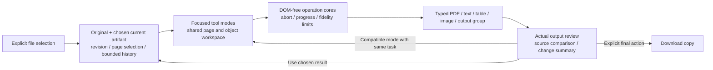

# BrowserPDF: complete service quality and document continuity program

## Primary goal

A person opens a document once, completes a task across BrowserPDF's 29 tools and three platform services without losing work, reviews the actual result, and exports a verified copy. Every audited service receives its specific quality improvement as well as compatible document continuity.

User authorization: “evet hepsini yap ve 32 servisin onerilerini vs hepsini improve et” (2026-10-18) supersedes the previous audit-only instruction. Baseline: `ab0a4f6`. Source scope: `DESIGN-IS-2026-10-18/05-service-improvements.md`, `03-verdict.md`, and `04-handoff-prompt.md`. All P0/P1/P2 items below require evidence; broad fidelity claims remain prohibited.

Latest steering: “imzalama filan cok iyi calismiyordu sanki” — signing felt unreliable. Preserve all 32 services, but prioritize Fill & Sign within Phase 2: real page-linked fields and drawn/typed/uploaded signatures with precise placement, proportional resizing, keyboard controls, reliable saved output and visible field/flatten failures. Root independently verifies the signing artifact journey after freeze.

## Phase 0 — Documentation discovery

**How this serves the primary goal:** implementation uses BrowserPDF's actual local-processing, storage, rendering, and accessibility contracts instead of replacing them with incompatible assumptions.

Read `README.md`, `docs/platform-architecture.md`, `docs/offline-vendoring-matrix.md`, the complete audit matrix, and existing tool/core/test patterns. Delegated discovery covers engine APIs and workspace/platform APIs. The planning orchestrator consolidates the reports.

Allowed APIs and copy locations:

- `public/js/tool-ui.js`: preserve `readPdfFile(file)`, `wireDropzone(dropzone,fileInput,onFiles)`, `takeChainedFile():Promise<File|null>`, `offerChain(bytes,name,targets)`, `downloadBytes(bytes,name,type)` and `renderPdfPageToCanvas(...)` compatibility while adding a typed session/result contract.
- `public/js/core/workflow-store.js`: `createWorkflowStore({indexedDb,now})`; `putWorkflowBundle(workflow,files)` atomic scoped ownership; `getWorkflow`, `getFile`, `deleteWorkflow`, `cleanupExpired`. Keep v2 database, owned IDs, expiry, immutable byte copies, and bounded history.
- `public/js/lib-loader.js`: `verifiedFetch({url,hash})`, `loadVerifiedGlobal(lib,globalName)`, `ensurePdfLib`, `ensurePdfJs`, `ensureTesseract`; pinned integrity-checked lazy libraries. pdf-lib 1.17.1 `registerFontkit(fontkit)`, `embedFont(bytes,{subset:true})`, `PDFFont.getCharacterSet()`, `PDFForm.updateFieldAppearances(font)` are present in installed source.
- PDF.js 6.2.108 `PageViewport.convertToPdfPoint(x,y)`, `convertToViewportPoint(x,y)`, `transform` in installed `types/src/display/page_viewport.d.ts`; use these exact transforms for CropBox plus 0/90/180/270 degrees. No invented `convertToViewportRectangle`.
- `public/js/core/privacy-scan.js` `withPdfDocument(pdfjs,bytes,{signal,pdfjsAssets},inspect)` owns copies and destroys loading tasks. `core/document-doctor-output.js` provides AbortSignal-render cancellation, 4096-dimension/16M-pixel bounds and reopen/render/page-count verification patterns.
- `public/js/pdf-convert.js` `convertPdfToMarkdown(file,opts,{onProgress,onStatus,onPageImage,signal})`; build a reusable page/text model before serializing. `md-blocks.js`, `md-layout.js` and `docx-writer.js` are shared parser/layout/writer extension points.
- `public/js/merge.js` supplies keyboard ordered list/abort patterns; `organize.js` supplies page operations; `workflows.js` supplies epoch-safe imports/serial queues; Privacy/Doctor supply verified manual-download result patterns.
- `tests/phase1.spec.mjs` through `phase9.spec.mjs`, `smoke.spec.mjs` and `tests/make-fixtures.mjs` validate real artifacts and architecture. Existing test discovery is 123 tests; README's 121 is stale.

Anti-pattern guards: no `web/pdf_viewer`, `AnnotationLayer`, `XfaLayer`, `PDFScriptingManager`, or `renderRichText` scripting surfaces (phase7 guard); no silent glyph removal, `?` substitution, cell truncation, blanket persistence, unbounded snapshots/canvases, auto-upload, CSP weakening, new backend, or claims of perfect Office conversion/full repair/full offline behavior. Original fixtures/audit evidence must remain intact.

## Phase 1 — Correct output and shared document foundation

**How this serves the primary goal:** repeated edits keep earlier work, text survives export, coordinates match the preview, and every route can carry a current typed result deliberately to a compatible tool.

Implement two coordinated workstreams: (A) shared Unicode font/metrics, text/page models, transforms and evidence-backed output fixes; (B) bounded typed document session/result UI, shared history and editor correctness. Copy ownership and cancellation patterns listed in Phase 0. Use original/current identity, revision, selection, operation generation and bounded history; persist only explicit task transitions, never passwords. Keep original immutable. Exports are idempotent for the same edit state. Results are reviewed before an explicit final download; explicit download buttons remain downloads.

Verification: Turkish and other covered-script text re-extracts intact; unsupported glyphs fail visibly; four rotations/nonzero CropBox placement, clipping and resized previews agree with saved artifacts; repeated exports do not duplicate edits; successive edits preserve first edit; current/source identity is visible; stale/cancelled operations cannot publish; typed outputs/multi-output groups are bounded and compatible; OCR and encrypted next steps respect capabilities; form failures are visible and do not report success.

Anti-patterns: silently rasterizing text to simulate Unicode, resetting current bytes to original on save, treating a Blob download as fidelity evidence, hidden intermediate downloads, passwords in IndexedDB/history, automatic restoration of an unrelated stale document into a fresh tool.

## Phase 2 — Shared object and page workspace

**How this serves the primary goal:** the focused edit/page routes become modes of a coherent document task with useful previews, selection, keyboard operation and undo/redo.

Extend shared lazy workspace adapters from the verified renderer/Organize patterns. Text/image/signature objects support actual appearance, multiple objects, selection, move/resize/delete, per-object properties and keyboard positioning; previews and exports share font metrics/transforms. Highlight supports text selection plus persistent per-object color/note; redact explicitly verifies removal and states page-structure loss. The reader provides selectable/searchable text, outline, thumbnails and zoom without PDF scripting surfaces. Page tools share range/odd/even/Shift selection and selected-page scope. Preserve all entry URLs and locales. Add insert/duplicate/group moves, merge source ranges, split named output list, drag crop box, page-number scope/start/font/margin, watermark logo/tile/custom position and image-composer options.

Signing priority details: trim transparent ink margins before proportional placement; capture pointer input so touch drawing does not scroll; Clear resets the placed draft consistently; wait for typed font loading and fit the full name before snapshot; map real AcroForm widgets to their actual pages. Independently verify typed Turkish names, drawn strokes and uploaded signatures; move/resize/undo/repeated export; page 2 plus rotated/CropBox preview parity. These are electronic image signatures, without digital-certificate or signature-validity claims.

Verification: one real text→image→signature→organize→review journey without download/reselection; keyboard-only object placement/selection and page manipulation; 320/390/768/1440 light/dark/RTL layouts; undo/redo and resize remain accurate; each page operation reopens with expected page/content/order; crop hides rather than claims removal; true redaction removes text/metadata according to its explicit scope. Every shared reader, thumbnail and object canvas bounds both its longest dimension and total pixels; an extreme-aspect-ratio page fixture verifies the memory guard, not only A4/Letter inputs.

Anti-patterns: a new skin over stale independent originals, two indefinite editor implementations, pointer-only controls, first-page-only previews, whole-document changes when a selection is displayed, white overlays described as redaction.

## Phase 3 — Conversion, OCR and compression quality

**How this serves the primary goal:** conversion results are inspectable and correctable before export, and common text, table, image and page content survives each supported transformation honestly.

Build shared text extraction, Unicode shaping/font fallback, wrapping/pagination and explicit paper/margin settings. Consolidate Markdown workspace and image composer behind retained URLs. PDF→Markdown/Word provides page references, side-by-side editable reading order/text/tables and examples of layout limits; Word→PDF handles lists/tables/images with actual PDF preview; Excel uses editable per-page grids, explicit column widths/wrapping/multi-sheet output, no truncation/substitution and empty extraction/OCR handoff. PDF↔Images exposes bounded estimates/cancel/output lists and the shared composer. OCR processes rotated/cropped pages, preserves recognized Unicode, exposes confidence/results and page retry/edit/cancel. Compression has a real structure-preserving optimization path plus an explicitly lossy raster path, review of size/quality/fidelity, and retains original when output does not reduce size. Prove structural optimization on a compressible corpus and preservation of text/forms/links; mere reserialization is insufficient evidence of meaningful compression.

Verification: saved-artifact corpus covers Turkish, Latin/Greek/Cyrillic and explicitly supported RTL/shaping, long tokens/cells, multi-sheet tables, numbered lists/images, columns, rotated scans, scan-only Excel rejection, literal punctuation, text/forms/links, image canvas/memory bounds and cancelled processing. Compare selected preview pages to exported results; validate edited conversion output content and generated DOCX/XLSX ZIP parts. Document engine licenses/dependency hashes/payload and measured fidelity limits before claiming completion.

Anti-patterns: unsupported text silently dropped; flattening OCR during suggested compression; blank workbook success; equal-column silent clipping; HTML preview passed off as actual PDF preview; perfect Office-layout claims; a no-op optimization advertised as compression.

## Phase 4 — Guided platform services and complete continuity

**How this serves the primary goal:** inspection, cleanup, recovery and batch processing act on the same chosen document, explain actionable findings and return useful results to the task.

Privacy Scan presents what/where/action with affected-page navigation and explicit coverage limits; cleaned verified output becomes current only by deliberate selection. Doctor explains least-lossy remedies, opens affected pages, compares source/result and imports chosen copy. Metadata shows before/after and controlled cleanup. Protect is a reviewed task-end encryption operation with show/hide; incompatible actions lead through Unlock and back to the original intended tool. Workflows imports the current PDF into the bounded queue, exposes selected output review/continue and a bounded recipe composer built only from shared supported step cores. Coherent typed results support Markdown/text/workbook/DOCX/images/ZIP groups without pretending all tools accept all formats. Review WebMCP, offline, translations and SDK boundaries.

Verification: current PDF→Privacy→metadata cleanup→Doctor→Workflows→chosen output→editor; protect→unlock→return-intent journey; private bytes/passwords absent from metadata-only tools and outbound requests; queue caps, atomic storage, cancellation/retry and expiry tests remain green; all 32 ledger rows have independent source plus saved-artifact or appropriate report/UI evidence.

Anti-patterns: blind related links, auto-selecting a lossy result, persisting passwords, exporting raw sensitive matches through WebMCP, claiming repair/privacy certification, arbitrary or unsupported workflow step composition.

## Phase 5 — Independent verification, review and delivery

**How this serves the primary goal:** the complete task and every service are proven against original-content and regression checks before the changes are called finished.

Fresh verification/review agents run the relevant artifact suites and anti-pattern checks after each phase, then the complete Playwright/SDK/migration/security-route release gate. Use installed pinned Chromium; do not weaken test expectations merely to obtain green results. Reconcile this ledger against implementation and evidence. Commit only verified focused changes, description-only commit messages. Work on an isolated feature branch; no main push or production deployment. Push the working branch/draft PR only when available and appropriate; use babysit on any actual PR/check cycle, never fabricate one. Preserve unrelated user files and audit artifacts.

Final evidence: exact test counts/commands, commit SHAs, clean/dirty status and remaining material limits. No row is complete merely because it gained a continuation link. Unfinished scope remains explicitly open.

## 32-service acceptance ledger

State begins **open**. Each row requires its specific behavior and compatible session/result integration. The implementing worker adds evidence paths/test names and only then marks verified.

| # | Service | Specific completion criteria | State / evidence |
|---|---|---|---|
| 1 | Add Text | Multiple selectable/movable text objects; real glyph preview; Unicode; exact rotated/CropBox transform; accumulation; undo/redo; idempotent export | open — [scene, preparation, keyboard and independent artifact evidence](../docs/object-shell-checkpoint.md); final shared-handoff/locale acceptance pending |
| 2 | Add Image | Correct selected-page preview; multiple images; drag/resize/keyboard; exact saved placement | open — [saved intake page/asset/order and independent scene journey](../docs/object-shell-checkpoint.md); final shared-handoff/locale acceptance pending |
| 3 | Fill & Sign | Priority: page-linked field placement; field/flatten errors block false success; drawn/typed/uploaded proportional movable/resizable keyboard signatures; non-form text mode; preview/export parity and no duplicate reapply | open — [form/signature, preparation, independent touch/bitmap and keyboard evidence](../docs/object-shell-checkpoint.md); final shared-handoff/locale acceptance pending |
| 4 | Highlight | Text selection, editable per-object color/note/delete/undo; readable result with persistent highlights | open |
| 5 | Redact | Exact coordinates; explicit lossy/page scope; verified removed text and metadata; direct post-redaction inspection; documented structural engine feasibility/evidence | open |
| 6 | View PDF | Select/search text, outline/thumbnails/zoom, shared current document and page-linked forms without scripting surfaces | open — [bounded text/search/outline, logical zoom, geometry, lifecycle, inherited-scene and independent saved-task evidence](../docs/reader-checkpoint.md); wider regression, annotation navigation seam and locales pending |
| 7 | Edit Metadata | Before/after properties, controlled standard cleanup, same-document Privacy handoff | open |
| 8 | Merge | Source thumbnails and page ranges, keyboard order, review combined current result | open — [actual range/order, transactional intake/clear, adoption and independent localized journey evidence](../docs/page-routes-checkpoint.md); final locale acceptance pending |
| 9 | Split | Ranges/odd-even/Shift selection; named per-result list/group; chosen PDF continues | open — [25-output list/ZIP, chosen result, editable names, cancellation and native replacement/early-Use recovery evidence](../docs/page-effects-checkpoint.md); final independent lifecycle review, legacy regression and locales pending |
| 10 | Organize | Shared panel, selected-group moves, insert/duplicate, history, review saved page order | open — [group/insert/duplicate, adoption and independent scene Undo artifact evidence](../docs/page-routes-checkpoint.md); final route/locale acceptance pending |
| 11 | Rotate | Shared page selection, group rotate/reset, changed-page summary, OCR-ready current result | open — [selected/reset, form/catalog, independent journey and OCR continuation evidence](../docs/page-routes-checkpoint.md); final route/locale acceptance pending |
| 12 | Delete Pages | Range/group/keep-selected, undo, remaining-page preview, cannot delete every page | open — [keep/delete/all-page guard and saved-order evidence](../docs/page-routes-checkpoint.md); final route/locale acceptance pending |
| 13 | Crop | Correct claim and box geometry; selected scope; drag crop; navigation and hidden-content warning | open — [four rotations, CropBox/UserUnit, drag, recoverable content and owned history/recovery artifact evidence](../docs/page-routes-checkpoint.md); final locale acceptance pending |
| 14 | Page Numbers | Range/start page/start number/font/margin; true selected-page preview and exported numbering | open — [selected numbering, geometry, retained forms/URI, deliberate text capability and independently exact saved preview evidence](../docs/page-effects-checkpoint.md); shared lifecycle/regression gate and locales pending |
| 15 | Watermark | Unicode; scope/navigation; logo/tile/custom placement; actual preview and export | open — [Unicode, normalized/transparent logos, sparse tiling, held replacement-logo and independently exact saved geometry evidence](../docs/page-effects-checkpoint.md); shared lifecycle/regression gate and locales pending |
| 16 | Compress | Real structural optimization and explicitly lossy path; preserve text/forms/links where promised; size/quality review; no larger auto-export | open |
| 17 | OCR PDF | Unicode and rotated pages; recognized/saved-text verification; page confidence/results/edit/retry/cancel | open |
| 18 | Protect | End-task encryption/review; show/hide; verified encrypted output; compatible Unlock transition | open |
| 19 | Unlock | Return to intended mode; preservation tests/explicit limits for forms/bookmarks/attachments/tags; result review | open |
| 20 | PDF → Markdown | PDF/text side-by-side, page refs, editable reading order and page OCR, compatible Markdown result | open |
| 21 | PDF → Word | Actual text/table/list/image-oriented preview; explicit fidelity limits; cancel; verified DOCX and continuation | open |
| 22 | Word → PDF | Unicode, numbered lists/tables/images; actual PDF review; evidence-based Office-fidelity feasibility | open |
| 23 | Extract Text | Direct text model retains punctuation; page boundaries/source and OCR status; localized states | open |
| 24 | PDF ↔ Images | Selection/resolution/memory estimate/cancel; output list; shared image composer and PDF review | open |
| 25 | Markdown → PDF | Shared workspace; actual paginated preview; Unicode; paper/margins/long-token wrap; export matches preview | open |
| 26 | PDF → Excel | Empty extraction blocked/OCR offered; editable grids/column correction; page/table tabs and valid workbook output | open |
| 27 | Excel → PDF | Unicode/no replacement; wrapping/no clipping; column widths; multi-sheet; actual print preview | open |
| 28 | JPG/PNG → PDF | Same composer as Images; thumbnails/order/rotate/fit-fill/A4-Letter/margins; reviewed PDF; both URLs work | open |
| 29 | Markdown Viewer | Same Markdown/PDF workspace; consistent parser/syntax; CommonMark support scope verified; generated PDF continues | open |
| 30 | Workflows | Import current; output/report review and chosen-result continue; bounded recipe composition from shared cores | open |
| 31 | Privacy Scan | What/where/action, affected-page opening, coverage limits, verified cleaned-copy continuation | open |
| 32 | Document Doctor | Plain problem/remedy explanation, least-lossy recommendation, affected-page/source-result review, chosen-copy continuation | open |

## Task architecture and cutover

The previous task is `select PDF → one operation → download → select that copy in the next tool`. The target task is `select once → edit/page/convert/inspect modes → review the chosen current revision → download once`.

The document toolbar identifies filename, revision and selected page, followed by Undo/Redo, mode navigation and review/export. Page thumbnails/ranges sit beside the zoomable page; selected-object properties appear close to the object. Mobile panels collapse while preserving the task. Conversion modes use the matching text/grid/image review rather than a pretend PDF canvas.

Cutover is complete only when the old route delegates to shared selection/history/renderer/operation contracts and its route-specific acceptance checks pass. Existing entry URLs and useful form/page controls remain available throughout. A lossy conversion or page-copy boundary records its explicit losses and can be undone to the previous artifact; it does not promise editable reconstruction of arbitrary existing PDF objects.

## Ownership and handoffs

The build orchestrator owns this plan, phase gates, coverage reconciliation, and assignment boundaries. At most two implementation workers run concurrently; they do not spawn nested workers. Root independently verifies/reviews the result and communicates user progress. Workers report exact files/APIs/tests/gaps; no unverified completion claims. Shared-file ownership is assigned before each phase, particularly `tool-ui.js`, `lib-loader.js`, `styles.css`, translations and test fixtures.

Phase 2 ownership agreed with the independent reviewer:

- **Objects:** `tool-ui.js`, `core/document-session.js`, `document-result.js`, `document-workspace.css`, persistent edit scene/assets, common reader/object workspace, Add Text/Image/Fill & Sign/Highlight/Redact/View routes and task-mode navigation. Scene objects must remain editable across routes; byte-only baked revisions do not satisfy this phase. Keep image/signature assets deduplicated and separately bounded from JSON history; move/delete/undo acts per object. No banned PDF scripting layers.
- **Pages:** shared page-operation/range/selection modules and separate scoped CSS; Merge/Split/Organize/Rotate/Delete/Crop/Page Numbers/Watermark; one image composer genuinely used by both Images and JPG/PNG entry URLs. Ask Objects for narrow shared-API changes rather than editing shared-owned files. Each adapter must call the actual shared selection contract and describe structural losses of page copying. Shared operation cores are the future workflow step implementation source.
- New global styles or translation dictionaries remain held until ownership is assigned explicitly. Existing route URLs remain. Phase 1 transactional intake evidence names only the three opted-in editors until the remaining adapters adopt candidate validation.

Phase 1 foundation verification approved: independent engine tests passed 10/10; root's `/tmp/browserpdf-root-phase1-final/results.json` independently proves actual downloaded two-stamp Turkish content and current Add Image handoff. The initial full suite passed 150/153, with exactly three old automatic-download test contracts subsequently migrated. Root's final targeted gate passed 27/27 (all 23 foundation tests, the three migrated Merge tests, and the unchanged initial-delivery guard); SDK build/checkdist/type/unit/package (8 unit tests) and all eight migration checks passed. Independent quality review re-proved the four original corrections, exact saved-signature RGB/alpha parity and the subsequently fixed sibling-result ownership race, including exact continuation bytes/MIME. Evidence is summarized in `docs/service-improvements-independent-review.md`. This closes the foundation phase only: all service-specific object/page/conversion/platform acceptance remains tracked below.
